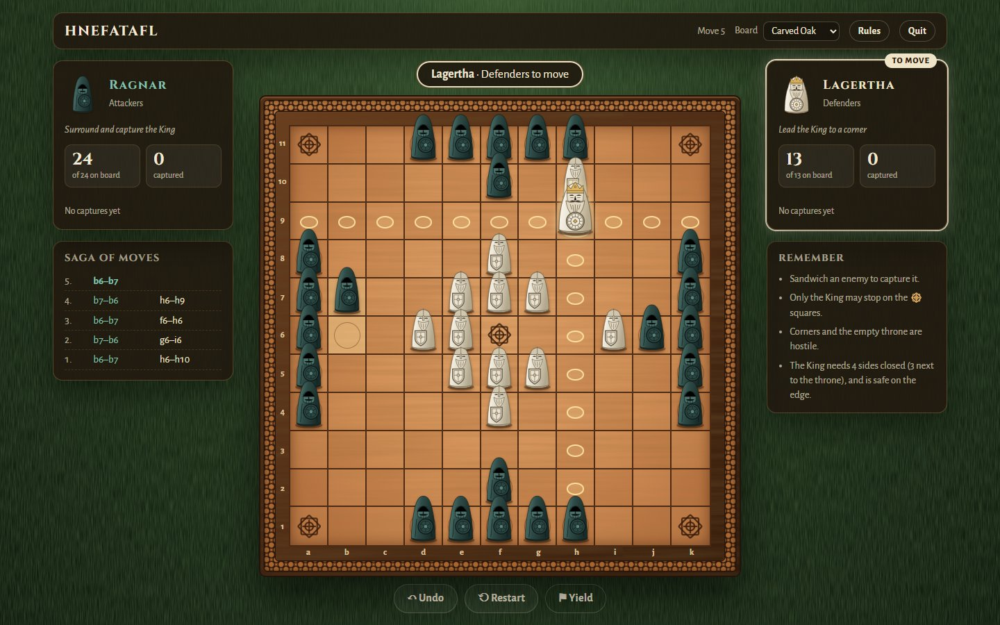
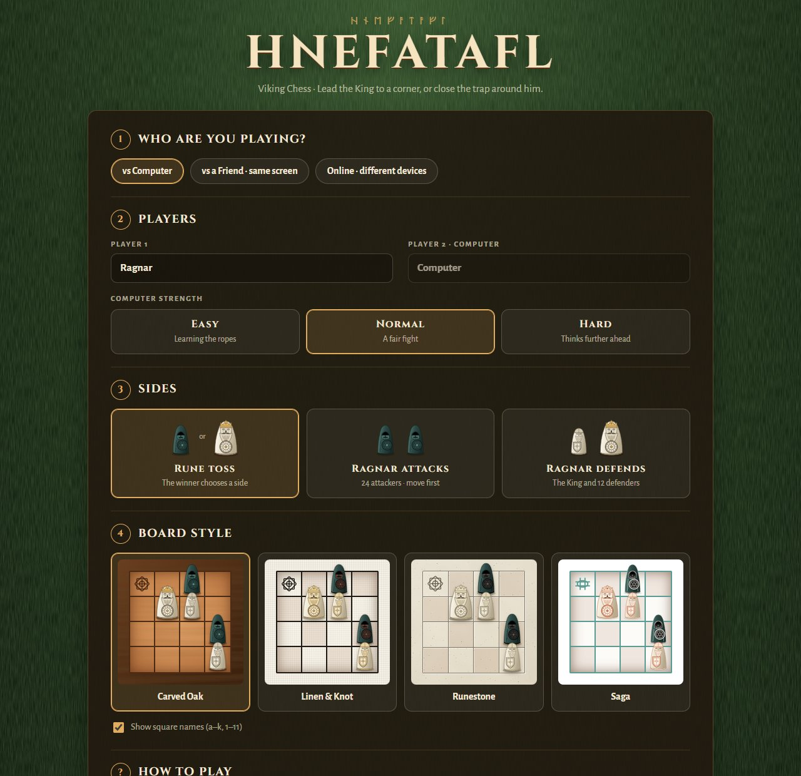
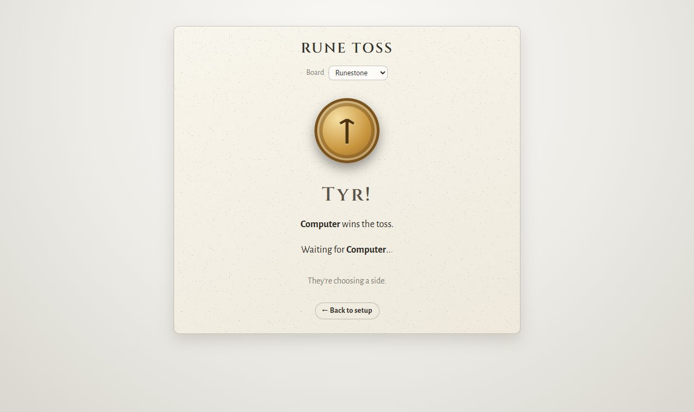
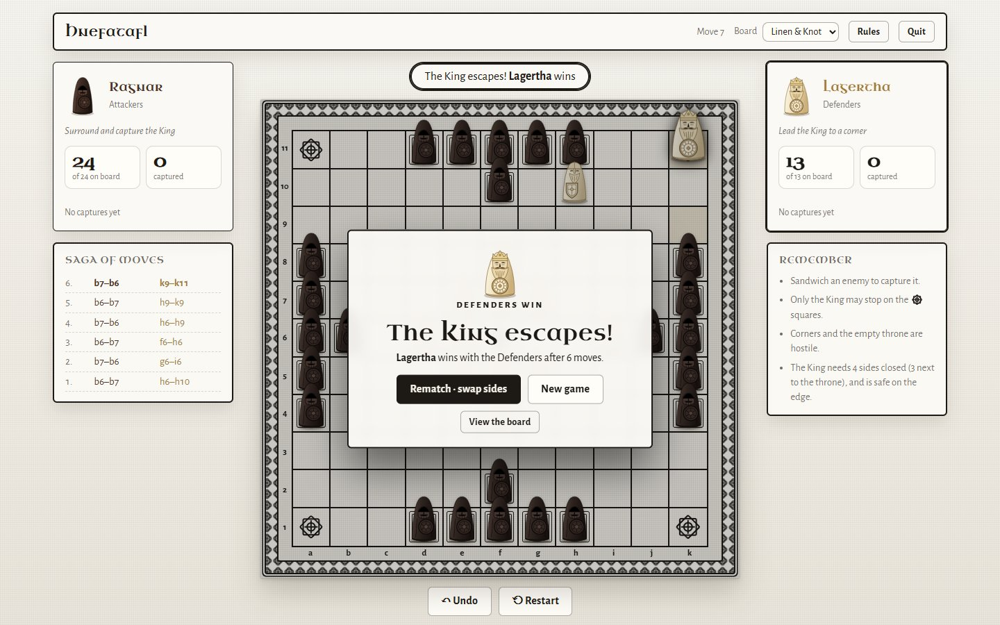
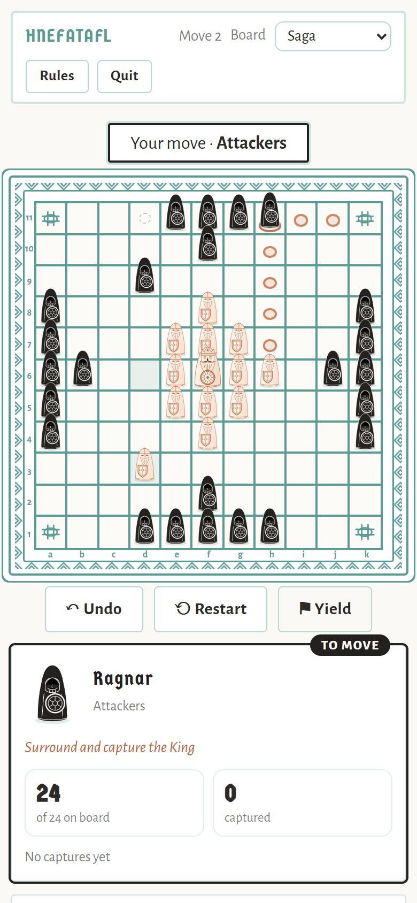
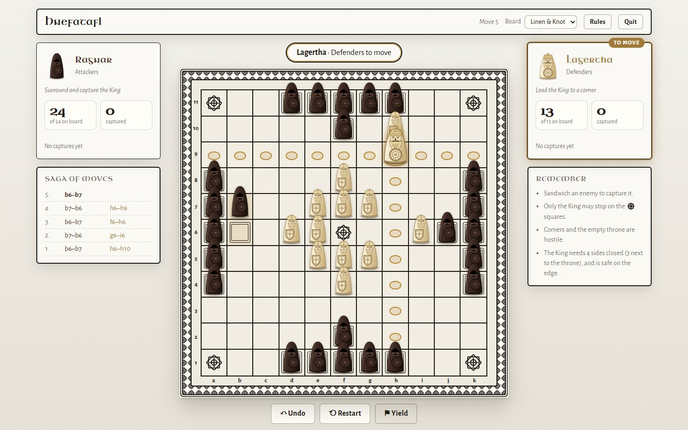
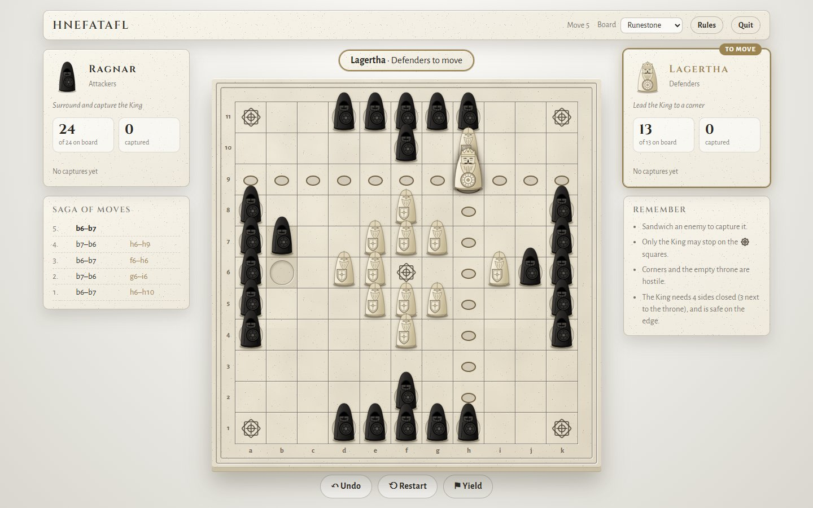
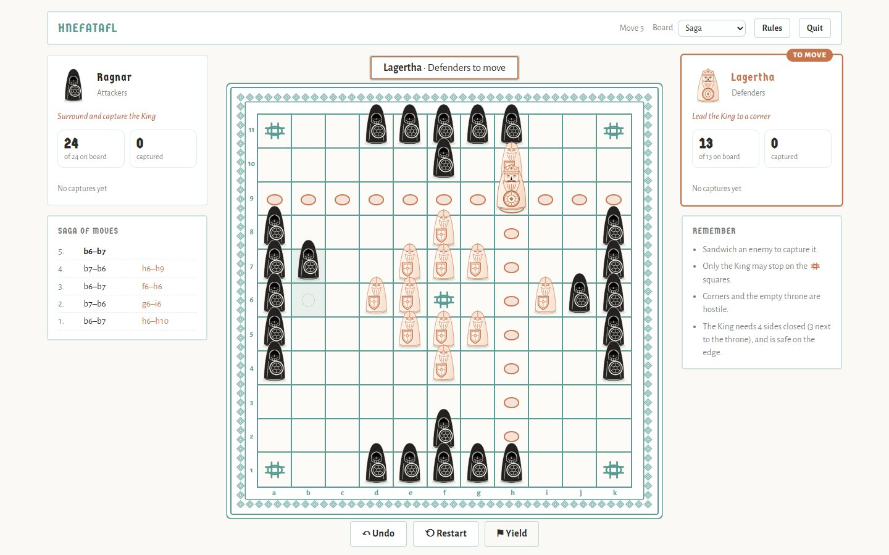

# Hnefatafl: Viking Chess

**▶ Play now: [hnefatafl-viking-chess.netlify.app](https://hnefatafl-viking-chess.netlify.app)**

A browser version of **Hnefatafl** ("the King's table"), the board game played across the Viking world. One side defends a King and tries to get him to a corner; the other side has twice as many warriors and tries to trap him.

Play against the computer, against a friend on the same screen, or **online** against a friend on another device with a 5-letter room code. Nothing to install.



## Features

- **Three ways to play:** against the computer (Easy, Normal, Hard), against a friend on the same screen, or **online** on different devices.
- **Carved figurine pieces** modelled on Viking sets: hooded attackers with round shields, helmeted defenders with cross shields, and a crowned, bearded King with a knotwork shield.
- **4 board styles:** Carved Oak, Linen & Knot, Runestone and Saga. Switch any time; online, each player keeps their own.
- **Rune toss** to decide sides, or pick them yourself.
- **Clear play:** your movable pieces lift on hover, valid squares are ringed, squares that would capture are marked in red, and the last move is highlighted.
- **Notices:** a call-out for every capture, warnings when the King has an open path to a corner or is nearly surrounded, and a victory card at the end.
- **Undo, Restart and Yield.** Online, undo and restart are requests the other player allows or declines.
- **Online games survive drop-outs:** saved seats, automatic reconnect, the computer stands in for a missing player, and the room creator can resume after a reload.
- **Works on phones, tablets and computers.**

## Screenshots

<table>
  <tr>
    <th>Setup</th>
    <th>Rune toss</th>
  </tr>
  <tr>
    <td></td>
    <td></td>
  </tr>
  <tr>
    <th>The King escapes</th>
    <th>On a phone</th>
  </tr>
  <tr>
    <td></td>
    <td align="center"></td>
  </tr>
</table>

## How to play

1. **Attackers move first.** Players take turns, moving one piece each turn.
2. **Move like a rook.** A piece slides any number of empty squares in a straight line. No diagonals, no jumping over pieces.
3. **Marked squares.** Only the King may stop on the throne (the centre) or the four corners. Other pieces may pass over the empty throne.
4. **Sandwich to capture.** Trap an enemy between two of your pieces in a row or column. Several pieces can fall in one move. Moving between two enemies yourself is safe.
5. **Hostile squares.** The corners, and the throne when it's empty, act as an enemy piece, so a piece next to them is easier to capture. The King is armed and helps his defenders capture.
6. **Capturing the King.** Attackers must close all four sides of him, or three sides plus the throne. He can't be captured on the board edge.
7. **Victory.** Defenders win when the King reaches a corner. Attackers win by capturing him. A side with no legal move loses.
8. **No endless loops.** If the same position comes up a third time, the game is a draw.

### Pieces

| Piece | Count | Goal |
|---|---|---|
| Attackers (dark, hooded, round shields) | 24, in a T on each edge | Surround and capture the King |
| Defenders (light, helmeted, cross shields) | 12, in a diamond round the King | Clear a path to a corner |
| King (crowned, great shield) | 1, on the throne | Reach any corner |

### The ruleset in detail

These are the common 11 × 11 rules (Copenhagen-style core rules), applied the same way everywhere in the game:

- **Board:** 11 × 11. The throne is the centre square (f6); the escape squares are the four corners.
- **Restricted squares:** only the King may stop on the throne or a corner. Other pieces may pass over the empty throne. The King may return to the throne.
- **Ordinary captures:** a piece is captured when the moving side closes it between two of its own pieces, or between one of its pieces and a hostile square, in a row or column. Captures only happen to the opponent of the side that moved.
- **Hostile squares:** corners are hostile to everyone. The empty throne is hostile to everyone. The throne with the King on it helps the defenders capture attackers, but never helps attackers capture defenders.
- **The King:** armed (he can be one side of a sandwich). He is captured only by attackers on all four sides, or on three sides when the fourth is the empty throne. He can't be captured on the board edge.
- **End of the game:** the King on a corner (defenders win); the King captured (attackers win); a side to move with no legal move loses; the third repetition of the same position (same board, same side to move) is a draw. A player can also yield.

## Game options

All chosen on the setup screen. Your last choices are remembered on your device.

### Opponent
- **vs Computer:** you are Player 1. Choose **Easy**, **Normal** or **Hard**.
- **vs a Friend · same screen:** two players take turns on one device.
- **Online · different devices:** see [Playing online](#playing-online).

### Sides
- **Rune toss:** Player 1 calls *Odin* or *Tyr*; the winner chooses Attackers or Defenders. If the computer wins, it picks.
- **Player 1 attacks** or **Player 1 defends:** skip the toss.
- **Rematch** at the end of a game swaps the sides.

### Board style
Switch on the setup screen or, mid-game, from the **Board** menu. An option shows the square names (a–k, 1–11) on the frame; the move log always uses them.

| Style | Look |
|---|---|
| **Carved Oak** (default) | Pyrographed wooden board on grass, burnt knotwork border, verdigris-green attackers and bone-white defenders |
| **Linen & Knot** | Printed canvas cloth, bold black grid, chain knotwork border, framed attacker squares, dark wood against ivory |
| **Runestone** | Speckled limestone slab, engraved lines, cupped attacker squares, black basalt against ivory |
| **Saga** | Flat illustrated rule-sheet look: teal grid and rune marks, black attackers in white line art, terracotta-lined defenders |

<table>
  <tr>
    <th>Linen &amp; Knot</th>
    <th>Runestone</th>
    <th>Saga</th>
  </tr>
  <tr>
    <td></td>
    <td></td>
    <td></td>
  </tr>
</table>

### During a game
- **Select** one of your pieces (they lift when you hover), then **click a ringed square** to move. Squares marked in red would capture something. Click the piece again, or press **Esc**, to put it down.
- **Undo** takes back the last move. Against the computer it takes you back to your own last turn.
- **Restart** puts the pieces back with the same sides. **Yield** ends the game in your opponent's favour.
- **Rules** opens the rules at any time.

## Playing online

1. **Create a room.** Choose **Online · different devices**, type your name, choose how sides are decided, and press **Create a room**. You get a 5-letter code like `NYBAR`.
2. **Your friend joins.** They open the same game on their own phone or computer, choose **Online**, and type the code.
3. **Start.** When their name appears in the room, press **Go to the rune toss** (or **Begin the battle** if sides are fixed).

Who controls what:
- The **room creator** chooses how sides are decided, calls the toss and starts rematches.
- Each player moves only their own pieces, on their own turn, on their own device.
- **Undo** and **Restart** are requests: the other player sees **Allow** / **Decline**.
- Each player picks their own board style.

### Leaving and coming back

**Seats are saved.** Once the game has started, only the device that joined can take seat 2, unless the room creator opens it.

**If the friend who joined drops out** (closed tab, lost signal):
- The room creator sees a 60-second countdown. If the friend is back in time, nothing changes.
- If not, **the computer plays their side** so the game can go on.
- A dropped connection reconnects automatically for about 2 minutes.
- If they closed the page, opening the game again shows **Rejoin**, which puts them back on their side.

**Switching device:** while seat 2 is empty, the room creator sees **Let someone else join**. The next person to enter the code takes over that side.

**If the room creator reloads or closes their tab,** the game is saved in their browser. Opening the game again shows **Resume game**, which reopens the same room; the other player reconnects automatically. If the old code is still busy, the game reopens with a new code to share.

**Saved games and seats last 12 hours.** The room creator pressing **Leave** ends the game for both players.

| Message | What to do |
|---|---|
| *Room not found* | Check the code. Rooms only exist while the room creator has the game open. |
| *Seat 2 is saved for …'s device* | The game already started with another device. Ask the room creator to tap **Let someone else join**. |
| *That room already has two players* | Someone else joined first. |
| *Reconnecting…* | Wait. It keeps trying for about 2 minutes. If the room creator reloaded, they need to tap **Resume game**. |
| Joining keeps failing | Some strict networks block direct connections. Try another Wi-Fi or mobile data. |

### How it works

Online play is peer-to-peer (WebRTC via [PeerJS](https://peerjs.com/)), matched through the free PeerJS server. No account or game server is needed. The room creator's browser runs the rules and sends the game state to the other player, who only sends their moves and answers. A heartbeat every 2 seconds notices a vanished player within about 10 seconds.

## The computer opponent

The computer searches ahead through possible moves (alpha-beta search) and scores each position by:
- open lanes from the King to a corner, and squares from which the King would threaten **two** corners at once (a fork attackers can't stop);
- attackers closing in on the King, and attackers sealing the squares in front of each corner;
- pieces left on each side, and how freely the King can move.

| Level | How it plays |
|---|---|
| Easy | Looks one move ahead, with plenty of randomness. Never misses a winning move. |
| Normal | Looks two moves ahead (its move and your reply). |
| Hard | Keeps looking deeper until about 1.3 seconds are up, usually 3–4 moves. |

It plays either side, chooses a side when it wins the toss, and stands in for online players who drop out.

## Running and hosting

- **Online:** the game is live at [hnefatafl-viking-chess.netlify.app](https://hnefatafl-viking-chess.netlify.app). Both online players must use the same web address to find each other's rooms.
- **Locally:** open `index.html` in any modern browser (Chrome, Edge, Firefox, Safari). No build step.
- **Offline:** vs Computer and same-screen games work offline. Fonts fall back to system fonts, and online rooms need internet.

### Updating the live site
The live site is published from a copy of the game in the `Viking_Chess_Online/` folder (kept on the owner's computer, not in this repository). That folder is linked to the Netlify site through its `.netlify` folder. After changing the game, copy the changed files into it and run this from inside it:

```
npx netlify-cli deploy --prod --dir .
```

Site dashboard: [app.netlify.com/projects/hnefatafl-viking-chess](https://app.netlify.com/projects/hnefatafl-viking-chess). Visitor protection is turned off so anyone with the link can play. To undo a bad update, publish an earlier deploy from the dashboard's **Deploys** page. Never copy the `Reference/` images into that folder.

### GitHub Pages (alternative)
In this repository go to **Settings → Pages**, set **Source** to *Deploy from a branch*, branch `main`, folder `/ (root)`, and save. After a minute the game is live at `https://<username>.github.io/Viking_chess/`. Online players must use the same address as each other.

### Tests

The rules and the computer player have tests that run in [Node.js](https://nodejs.org/) without any packages:

```
node tests/engine.test.js   # rules: moves, captures, the King, endings, undo, 300 random games
node tests/ai.test.js       # computer: takes wins, blocks escapes, full games at each level (about a minute)
```

## Project structure

```
index.html              page shell, fonts, PeerJS, theme stylesheets
css/base.css            layout and components shared by every board style
css/themes/*.css        one file per board style: oak, linen, runestone, saga
js/engine.js            rules and game state (no UI code)
js/ai.js                the computer player
js/net.js               online connections (PeerJS): room codes, seat passes, heartbeat
js/pieces.js            SVG figurines and board marks, coloured by the theme
js/ui.js                screens, clicks, online lobby, syncing, saving and rejoining
tests/                  Node tests for the rules and the computer
docs/screenshots/       screenshots used in this README
last_Update.md          what the game does now, version history, and how to record changes
```

## Customising

- **Rules:** everything is in `js/engine.js`: the starting layout (`START_ATTACKERS`, `START_DEFENDERS`), hostile squares (`hostile()`), king capture (`kingCaptured()`) and the repetition limit (`REPEAT_LIMIT`). Run the tests after changing anything.
- **Computer:** strengths are `LEVELS` at the top of `js/ai.js`; the scoring is `evaluate()`.
- **Board styles:** copy a file in `css/themes/`, change the selector to `[data-theme="yourstyle"]` and the variables inside it (`--a-*`, `--d-*` and `--k-*` colour the pieces). Then link it in `index.html` and add it to `THEMES` in `js/ui.js`.
- **Pieces:** the figurines are SVG drawings in `js/pieces.js`.
- **Rules text:** the "How to play" list is `RULES` at the top of `js/ui.js`.
- **Online timings:** `TAKEOVER_SECONDS` (60) and `SAVE_HOURS` (12) are in `js/ui.js`; the heartbeat is in `js/net.js`.

## Notes

- The design was based on photos of real Hnefatafl sets and an illustrated rule sheet. Those reference images are not part of this repository.
- Settings are saved in your browser's local storage. Online games are saved in the room creator's browser for 12 hours; vs Computer and same-screen games are not saved, so a reload starts over.
- In online games the room creator's browser runs the rules, so a player with technical know-how could tamper with it. It's meant for friendly games.

<details>
<summary>Original brief</summary>

### Hnefatafl – Viking Chess
#### Game Rules & Implementation Instructions

##### 1. Game Overview
Hnefatafl is an ancient Norse strategy board game, commonly known as Viking Chess.

It is a two-player asymmetric strategy game. One player controls a king and a smaller defending army, while the other controls a larger attacking army.

Unlike traditional chess, both players have different objectives.

##### 2. Board Setup
Use the commonly played 11 × 11 board.

**Pieces:**
- 1 King
- 12 Defenders
- 24 Attackers

**Initial arrangement:**
- Place the King in the centre of the board.
- Arrange the 12 Defenders around the King.
- Arrange the 24 Attackers in formations along the four edges.
- Mark the four corner squares as the King's escape locations.
- Mark the central square as the throne.

##### 3. Player Objectives

**Defender:**
Protect the King and help him reach any one of the four corner squares.

**Attacker:**
Surround and capture the King before he escapes.

##### 4. Movement Rules
- Players alternate turns.
- Each turn allows one piece to move.
- All pieces move horizontally or vertically.
- Pieces can move any number of empty squares in a straight line.
- Pieces cannot jump over other pieces.
- Pieces cannot move through occupied squares.
- Only the King can occupy the four corner squares.
- The central throne is reserved for the King.

##### 5. Capture Mechanics

Ordinary pieces are captured using the sandwich capture rule.

A piece is captured when it becomes trapped between two opposing pieces horizontally or vertically.

**Example:**
1. An enemy piece is positioned between two friendly pieces.
2. One friendly piece is already on one side.
3. The player moves another friendly piece to the opposite side.
4. The trapped enemy piece is removed from the board.

Additional rules:
- Multiple pieces can be captured in one move.
- A piece voluntarily moving between two enemy pieces is generally not captured immediately.
- Captures occur horizontally and vertically, never diagonally.

##### 6. King Capture Rules

The King has special capture requirements.

- Away from special squares, the King must be surrounded on all four sides.
- Near the central throne or a hostile corner square, those special squares can count as part of the surrounding.
- Once captured, the game ends and the attacker wins.

Implement the exact capture conditions consistently throughout the game.

##### 7. Winning Conditions

**Defender Victory:**
The King reaches any one of the four corner squares.

**Attacker Victory:**
The King is successfully captured.

##### 8. Basic Strategies

**Defender Strategy:**
- Keep the King protected.
- Create escape routes.
- Use defenders to block attackers.
- Avoid allowing the King to become surrounded.

**Attacker Strategy:**
- Control the outer lanes.
- Block the King's escape routes.
- Coordinate attacks.
- Gradually surround the King.

##### 9. Gameplay Requirements
- Display the complete 11 × 11 board.
- Clearly distinguish the King, Defenders, and Attackers.
- Highlight selectable pieces and valid movement destinations.
- Allow players to select and move pieces.
- Automatically detect captures.
- Remove captured pieces from the board.
- Prevent illegal movements.
- Detect victory conditions.
- Display whose turn it is.
- Provide Restart and Undo options.

##### 10. Important Design Considerations
- Keep the interface clean and easy to understand.
- Use distinct visual designs for each piece type.
- Make valid moves visually clear.
- Show a clear notification when a piece is captured.
- Display a victory message when either side wins.
- Do not introduce unnecessary chess mechanics.

##### 11. Ruleset
Use the common 11 × 11 Hnefatafl ruleset as the initial implementation target.

Historical Hnefatafl variants differ in board size, starting positions, and some capture rules. Keep the rules consistent with the selected version rather than mixing different variants.

</details>
